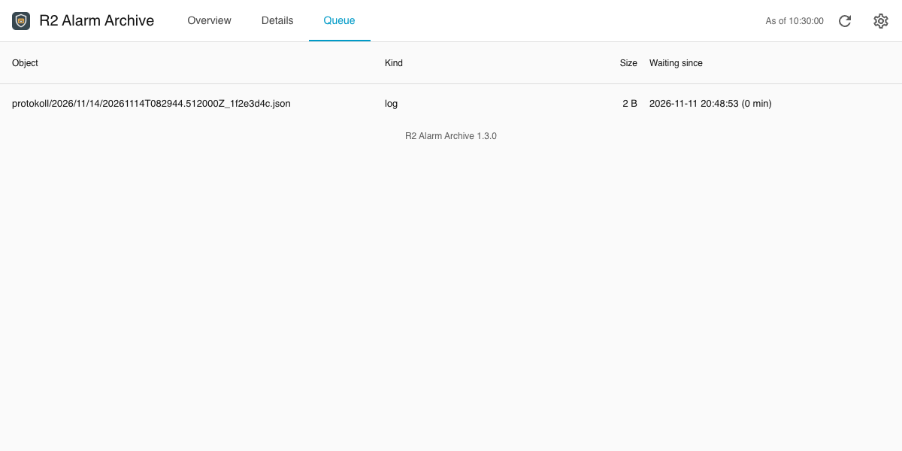
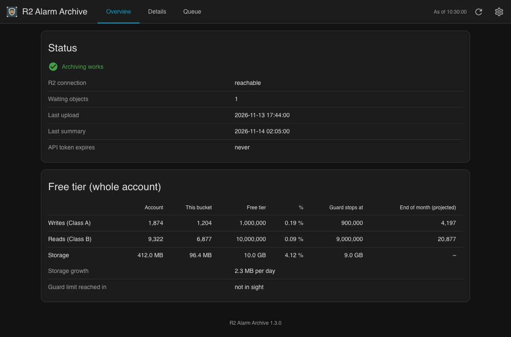
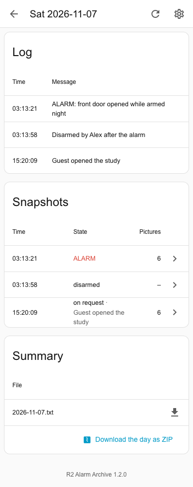
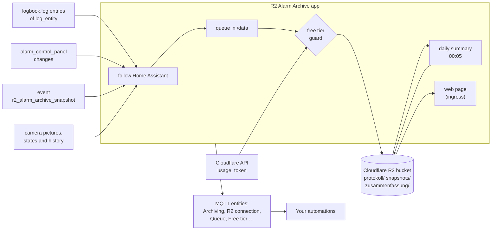

# R2 Alarm Archive

[](https://github.com/n-schilling/ha-app-r2-alarm-archive/releases)
[](https://github.com/n-schilling/ha-app-r2-alarm-archive/actions/workflows/ci.yaml)
[](LICENSE)


A Home Assistant app that keeps the alarm log outside the house: it follows the log in the recorder and puts every entry into a Cloudflare R2 bucket, adds a snapshot of states and camera pictures whenever the alarm panel changes or an automation asks for one, and writes a summary of each day. Objects are created once and never overwritten; an optional free tier guard keeps the whole Cloudflare account 10 % below the limits of R2's free tier. A read-only page of its own in Home Assistant shows the archive, its days, snapshots and pictures, and the free tier in detail, without going to the Cloudflare dashboard.

Requires Home Assistant 2026.11 or later.

## Screenshots

The page looks like Home Assistant's settings, takes over the theme in use and speaks the language of Home Assistant's interface (German or English). The data in the pictures is made up for these pictures.








## Overview



How the log, snapshots, summaries and the free tier guard work is in [the documentation](r2_alarm_archive/DOCS.md); changes are in the [changelog](r2_alarm_archive/CHANGELOG.md).

## Installation

1. Add the repository to your Home Assistant instance:

   [](https://my.home-assistant.io/redirect/supervisor_add_addon_repository/?repository_url=https%3A%2F%2Fgithub.com%2Fn-schilling%2Fha-app-r2-alarm-archive)

   Or add it manually: **Settings → Apps → Install app → ⋮ → Repositories**, then paste:

   ```text
   https://github.com/n-schilling/ha-app-r2-alarm-archive
   ```

2. Install **R2 Alarm Archive** from the app store.
3. Prepare Cloudflare and Home Assistant as in [Requirements](r2_alarm_archive/DOCS.md#requirements), fill in the options and start the app.

## Development

The app is a Python package in [`r2_alarm_archive/rootfs/usr/lib/r2_archive`](r2_alarm_archive/rootfs/usr/lib/r2_archive); the page's look comes from the stylesheet shared by these apps, [`ha.css`](r2_alarm_archive/rootfs/usr/local/share/ha-app/ha.css), and its language from the script shared by them, [`ha-lang.js`](r2_alarm_archive/rootfs/usr/local/share/ha-app/ha-lang.js); both stay identical in every app.

```bash
python3 -m venv .venv
.venv/bin/pip install --require-hashes -r r2_alarm_archive/requirements.txt
.venv/bin/pip install -r requirements_test.txt
scripts/check.sh
```

`scripts/check.sh` runs what CI runs (changelog, shellcheck, ruff, tests, and when Docker runs the image built and started and the Page check; `--no-image` skips those). The Page check and the screenshots are one script, `scripts/screenshots.py` (see its header for the setup): it starts the built image in a throwaway container with made-up data (`scripts/demo.py`), opens the page with headless Chromium as Home Assistant's ingress would, and checks every page in light, dark and at phone width: the top bar (name, *As of* stamp, refresh, settings link with `target="_top"` and the slug), the version line, and no console errors or CSP violations. With `--out docs/screenshots` it also draws the screenshots.

The image's packages are listed in [`requirements.in`](r2_alarm_archive/requirements.in); [`requirements.txt`](r2_alarm_archive/requirements.txt) pins them and everything they pull in with their hashes, and the image installs it with `--require-hashes`. After changing `requirements.in`, run `uv pip compile requirements.in --generate-hashes --universal --python-version 3.14 -o requirements.txt` in `r2_alarm_archive`.

Releases: work on `dev`, raise `version` in `r2_alarm_archive/config.yaml` and add its section to the changelog. CI runs on `dev` (amd64 and aarch64 each on a runner of its own kind); once it is green, push that commit to `main`. CI does not run again there: the release workflow checks that CI passed for the commit, then tags the version and publishes the release with that section.

## Support

Questions, bugs and ideas: [open an issue](https://github.com/n-schilling/ha-app-r2-alarm-archive/issues/new/choose) in this repository. Security problems: see [SECURITY.md](SECURITY.md).

## License

[Apache License 2.0](LICENSE)
