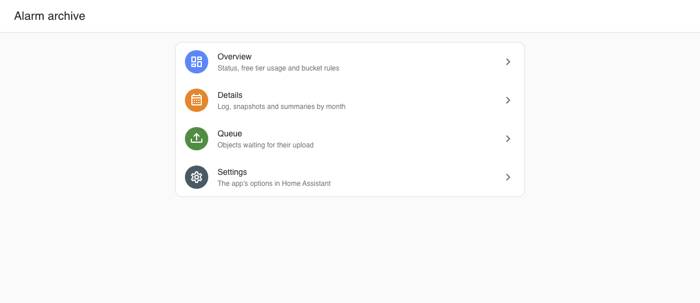
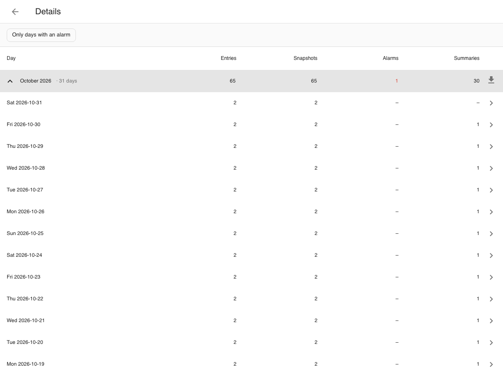
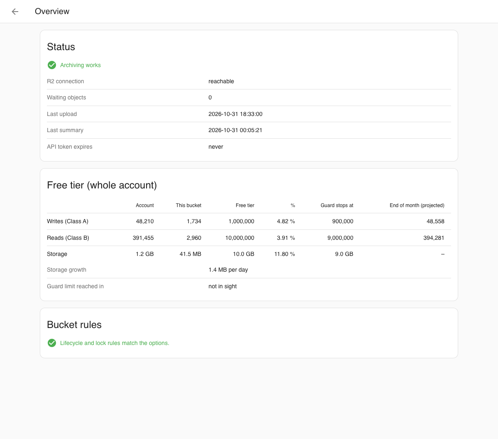
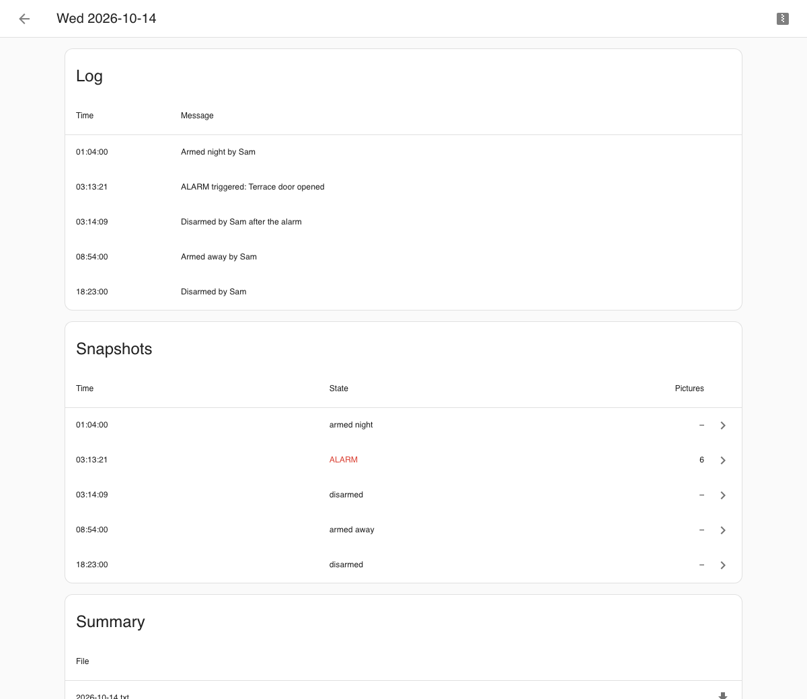
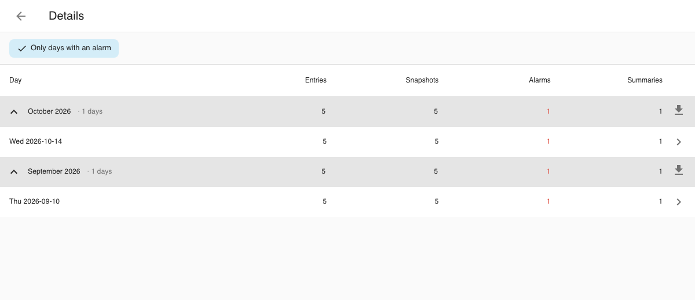
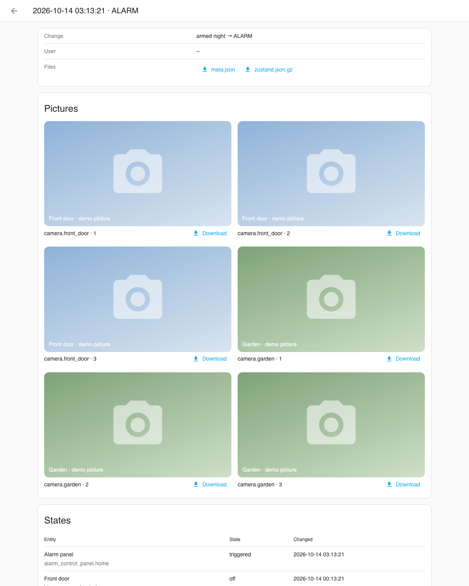

# R2 Alarm Archive app for Home Assistant

[](https://github.com/n-schilling/ha-app-r2-alarm-archive/releases)
[](https://github.com/n-schilling/ha-app-r2-alarm-archive/actions/workflows/ci.yaml)
[](LICENSE)


A Home Assistant app (formerly add-on) that keeps the alarm log outside the house: it follows the log in the recorder and puts every entry into a Cloudflare R2 bucket, adds a snapshot of states and camera pictures whenever the alarm panel changes, and writes a summary of each day. Objects are created once and never overwritten; an optional free tier guard keeps the whole Cloudflare account 10 % below the limits of R2's free tier. A read-only page in the sidebar shows the archive, its days, snapshots and pictures, and the free tier in detail, without going to the Cloudflare dashboard.

## The web page

The page in the sidebar looks like Home Assistant's settings and takes over the theme in use. The screenshots show made-up demo data.

| Menu | Details by month |
|---|---|
|  |  |
| **Overview** | **A day** |
|  |  |
| **Only days with an alarm** | **A snapshot with a picture series** |
|  |  |

## Installation

1. Add the repository to your Home Assistant instance:

   [](https://my.home-assistant.io/redirect/supervisor_add_addon_repository/?repository_url=https%3A%2F%2Fgithub.com%2Fn-schilling%2Fha-app-r2-alarm-archive)

   Or add it manually: **Settings → Apps → Install app → ⋮ → Repositories**, then paste:

   ```text
   https://github.com/n-schilling/ha-app-r2-alarm-archive
   ```

2. Open the app from the app store.
3. Install **R2 Alarm Archive**, fill in the options and start it.

See [the documentation](r2_alarm_archive/DOCS.md) for what to prepare in Cloudflare, the options, entities and troubleshooting. Changes are listed in the [changelog](r2_alarm_archive/CHANGELOG.md).

## Setting up Home Assistant for the archive

The app does not need to know how your alarm system is built. It archives two things you point it to: a **log** written with Home Assistant's logbook, and, optionally, **snapshots** of an alarm panel. Everything else stays in your own automations.

### 1. A log entity

Create one entity that carries the log, e.g. a toggle helper **Alarm log** (`input_boolean.alarm_log`) under **Settings → Devices & services → Helpers**. It is only an anchor: nothing ever switches it, and it must not be excluded from the recorder. Set it as `log_entity`.

### 2. Write log entries

Every call of `logbook.log` with that entity becomes one entry in the archive; its `message` is the text. Write entries wherever something worth keeping happens: when the panel changes, when arming is refused, when a sensor trips. A starting point that logs every change of the panel and who made it:

```yaml
alias: Alarm log – panel changes
triggers:
  - trigger: state
    entity_id: alarm_control_panel.home
    not_to: [unavailable, unknown]
    not_from: [unavailable, unknown]
actions:
  - action: logbook.log
    data:
      name: Alarm
      entity_id: input_boolean.alarm_log
      message: >-
        {{ trigger.from_state.state }} → {{ trigger.to_state.state }}
        
         by {{ by }}
mode: queued
```

Write the message so it can be read on its own later, years from now and without Home Assistant: names instead of entity IDs, what happened and why. The daily summary shows each entry as `DD.MM.YYYY HH:MM:SS - <message>`.

The log does not have to be an alarm log. Any entity works as `log_entity`, for example one for the door lock or for the safe; one app archives one log.

### 3. Snapshots (optional)

Set `alarm_panel` to an `alarm_control_panel` entity, and the app saves a snapshot each time the panel changes to one of `snapshot_states`. What goes in:

- **States** of the entities in `snapshot_entities`, plus the panel itself. Put in what tells the story of an alarm: door and window contacts, motion sensors, persons. A group counts with its members, so listing your alarm groups is enough. `snapshot_all_entities` takes everything instead (larger, about 0.1 MB per snapshot for 1,500 entities).
- **Pictures** of each camera in `cameras`, but only for the panel states in `camera_states` (by default only `triggered`): a series of `camera_pictures` (default 3), `camera_interval` seconds apart (default 10). A picture is about 0.6 MB, so pictures on every arming and disarming add up to a few hundred MB a month.

The lists in the app's options have no entity picker: type the full entity ID, e.g. `camera.front_door`, and choose *Add custom item*.

Without `alarm_panel` the app archives the log only.

### 4. React to the status (recommended)

The app reports through MQTT discovery whether archiving works. For a dashboard one entity is enough: **Archiving** (`binary_sensor.r2_alarm_archive_archiving`) is on while the log reaches R2 and off when something is wrong; its attribute `problems` says what. The other entities (R2 connection, queue, last upload and summary, free tier usage) show the details.

A notification when archiving stays broken:

```yaml
alias: Alarm archive – not working
triggers:
  - trigger: state
    entity_id: binary_sensor.r2_alarm_archive_archiving
    to: "off"
    for: "00:15:00"
actions:
  - action: notify.notify
    data:
      title: Alarm archive
      message: >-
        {{ state_attr('binary_sensor.r2_alarm_archive_archiving', 'problems') | join(', ') }}
mode: single
```

The entity IDs are those Home Assistant usually gives; check them on the device **R2 Alarm Archive**.

### What you can configure

| Area | Options |
|---|---|
| Cloudflare | `account_id`, `bucket`, `jurisdiction` (`default` or `eu`), the R2 key (`access_key_id`, `secret_access_key`), a read-only `api_token` |
| What is archived | `log_entity`; for snapshots `alarm_panel`, `snapshot_states`, `snapshot_entities` or `snapshot_all_entities`, `cameras`, `camera_states`, `camera_pictures`, `camera_interval` |
| Costs | `free_tier_guard`: keep the whole Cloudflare account 10 % below the limits of R2's free tier (on by default) |
| Retention | `retention_log`, `retention_snapshots`, `retention_summaries`: days or `unlimited` |
| Protection | `lock_log`, `lock_snapshots`, `lock_summaries`: bucket lock `off`, `indefinite` or days |
| MQTT | `discovery_prefix`; `mqtt_host` and friends only for a broker the Supervisor does not know |

Retention and lock are rules of the bucket: you set them in Cloudflare, and the app checks once a day that they match these options (see [the documentation](r2_alarm_archive/DOCS.md#retention-and-bucket-lock)). Fixed by design: one object per entry that is never overwritten, the folder names in the bucket, and the daily summary at 00:05 in Home Assistant's time zone.

## Development

The app is a Python package in [`r2_alarm_archive/rootfs/usr/lib/r2_archive`](r2_alarm_archive/rootfs/usr/lib/r2_archive). Tests:

```bash
pip install -r r2_alarm_archive/requirements.txt pytest pytest-aiohttp
pytest
```

## Support

Questions, bugs and ideas: [open an issue](https://github.com/n-schilling/ha-app-r2-alarm-archive/issues/new/choose) in this repository. Security problems: see [SECURITY.md](SECURITY.md).

## License

[Apache License 2.0](LICENSE)
