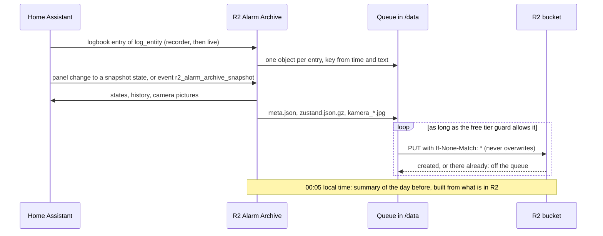
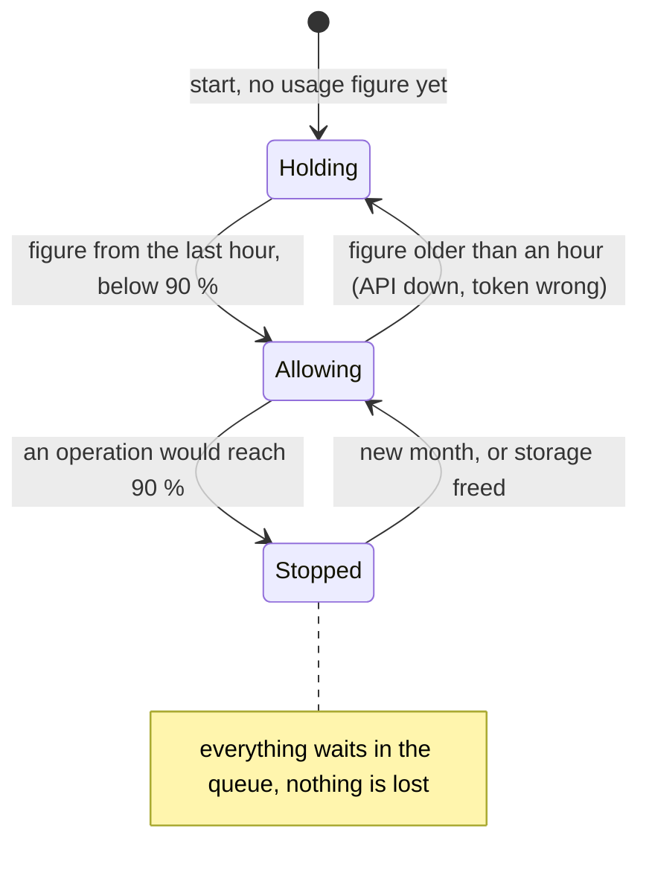

# R2 Alarm Archive

Keeps the alarm log of Home Assistant outside the house: every log entry goes to a Cloudflare R2 bucket as soon as it is written, together with a snapshot of the states and camera pictures whenever the alarm panel changes or an automation asks for one, and a summary of each day. If the Home Assistant machine is stolen or destroyed, the log is still there.

The app reads the log from Home Assistant's recorder and resumes where it stopped, so a restart, an update or an outage loses nothing the recorder still has. Everything waits in a queue on the machine until R2 has confirmed it. Objects are created once and never overwritten; with a bucket lock not even the app's key can delete them.



## Requirements

- Home Assistant 2026.11 or later with the recorder (default).
- An MQTT broker for the status entities, e.g. the Mosquitto broker app with the MQTT integration. Without one the app archives anyway; its entities appear once a broker is there.
- In Cloudflare:
  1. An R2 bucket for this archive only, storage class **Standard**.
  2. An R2 API token (**R2 → Manage API tokens**) with **Object Read & Write**, limited to this bucket. Its access key ID and secret go into the options. This key can also delete objects; a bucket lock prevents that (see [Retention and bucket lock](#retention-and-bucket-lock)).
  3. For the free tier guard and the rule check: an account API token (**My Profile → API Tokens**, or account API tokens) with **Account Analytics Read** and **Workers R2 Storage Read**. Both permissions only read.
- Recommended: turn on **Watchdog** on the app's page (**Settings → Apps → R2 Alarm Archive**), so Home Assistant starts the app again should it ever stop.

## Options

The app does not need to know how your alarm system is built. It archives what you point it to: a **log** written with Home Assistant's logbook and, optionally, **snapshots** of an alarm panel. Everything else stays in your own automations.

### Log

Create one entity that carries the log, e.g. a toggle helper **Alarm log** (`input_boolean.alarm_log`) under **Settings → Devices & services → Helpers**. It is only an anchor: nothing ever switches it, and it must not be excluded from the recorder. Set it as `log_entity`.

Every call of `logbook.log` with that entity becomes one entry in the archive, its own object `protokoll/YYYY/MM/DD/<UTC time>_<hash>.json`; its `message` is the text. Write entries wherever something worth keeping happens (see [Example automations](#example-automations)). Write the message so it can be read on its own later, years from now and without Home Assistant: names instead of entity IDs, what happened and why. The first start reads everything the recorder has.

The log does not have to be an alarm log. Any entity works as `log_entity`, for example one for the door lock or for the safe; one app archives one log.

### Snapshots

Set `alarm_panel` to an `alarm_control_panel` entity, and the app saves a snapshot each time the panel changes to one of `snapshot_states`, under `snapshots/YYYY/MM/DD/<UTC time>_<state>/`:

- `zustand.json.gz`: the states of `snapshot_entities` plus the panel, or of all entities with `snapshot_all_entities` (about 0.1 MB per snapshot for 1,500 entities). Put in what tells the story of an alarm: door and window contacts, motion sensors, persons. A group counts with its members, three levels deep, so listing your alarm groups is enough. Access tokens in attributes (`access_token`, `entity_picture`) are left out.
- `kamera_<camera>.jpg`: pictures of each entity in `cameras`, only when the new state is in `camera_states` (default: only `triggered`). All cameras are asked at the same moment. With `camera_pictures` above 1 the app takes a series: the first picture at once, the others every `camera_interval` seconds as `kamera_<camera>_2.jpg`, `_3` and so on (default: 3 pictures, 10 s apart). A picture is about 0.6 MB, so pictures on every arming and disarming add up to a few hundred MB a month.
- `meta.json`: from and to state, the panel's attributes, the user, which pictures are missing and which files the series has.

Was the app not running at the time, it rebuilds the states from the recorder at its next start, marks the snapshot as `reconstructed` and lists the pictures as missing. Snapshots start with the app's first start.

The lists in the app's options have no entity picker: type the full entity ID, e.g. `camera.front_door`, and choose *Add custom item*. Without `alarm_panel` the app archives the log and the snapshots automations ask for.

### Snapshots on request

An automation can ask for a snapshot at any time, whatever the panel's state: it fires the event `r2_alarm_archive_snapshot`, optionally with a `reason` (text; up to 200 characters are kept). Each event gives one snapshot in `snapshots/YYYY/MM/DD/<UTC time>_request/` at the moment the event was fired: the same `zustand.json.gz` as above, a picture series of every camera in `cameras` (`camera_states` does not apply), and a `meta.json` with the panel's current state as `from`, `request` as `to` and the `reason`. Two events at the same moment give two snapshots; the second folder's time is one microsecond later. It works also without `alarm_panel`, and it does not count as an alarm.

### Daily summary

At 00:05 local time (Home Assistant's time zone) the app writes `zusammenfassung/YYYY/MM/YYYY-MM-DD.txt`: one line per entry of the day before, its snapshots, and the SHA-256 of every entry. It is built from what is in R2, so it shows what really arrived, and it waits until nothing of that day is in the queue. Entries that reach R2 later go into `…-nachtrag-1.txt`, `-2` and so on. Folders follow the local date, times inside the objects are UTC.

### Free tier guard

R2's free tier is per Cloudflare account, not per bucket: 10 GB-month of storage, 1 million Class A and 10 million Class B operations a month (Standard storage only). With `free_tier_guard` on, the app keeps the **whole account**, including everything else you run on it, **10 % below every one of these limits**:

| | Free tier | The app stops at |
|---|---|---|
| Storage (all buckets) | 10 GB-month | 9 GB |
| Class A operations (PUT, LIST) | 1,000,000 / month | 900,000 |
| Class B operations (GET, HEAD) | 10,000,000 / month | 9,000,000 |

Every 15 minutes the app reads the account's usage from Cloudflare's GraphQL Analytics. The analytics lag a few minutes, so the app adds its own operations of the last 10 minutes on top; for a while some count twice, never none. Before every operation it checks that the operation keeps all three figures below their limit. The month counts from the 1st, 00:00 UTC.



At the limit **everything stops**, the log too. Nothing is lost: it waits in the queue until the new month starts or storage is freed. In normal use the app needs far less: a few hundred PUTs and some megabytes a month.

### Retention and bucket lock

Each kind of data (log, snapshots, summaries) has its own retention and its own bucket lock. The app **does not set** lifecycle or lock rules: a token that can set a lock can remove it too, and on the Home Assistant machine it would let anybody with access to that machine remove the lock and then delete. The app only checks once a day that the bucket's rules match the options and reports a difference in the entity *Bucket rules differ*, with the Wrangler commands that would fix it in its attributes, on the web page and in the log. For example, with the default options:

```bash
npx wrangler r2 bucket lifecycle add <bucket> delete-snapshots snapshots/ --expire-days 365
```

**Without a lock the app's own R2 key can delete the archive.** Whoever takes over the Home Assistant machine, or gets hold of that key, can then remove exactly the evidence the archive is for. A lock rule per prefix prevents that, e.g. `lock_log: indefinite` with the matching rule `npx wrangler r2 bucket lock add <bucket> lock-log protokoll/ --retention-indefinite`. The overview on the web page says when no lock is set. A lock keeps objects even past their retention, so the options refuse a lock longer than the retention of the same kind.

### All options

| Option | Default | Meaning |
|---|---|---|
| `account_id` | | Cloudflare account ID, 32 hex digits |
| `bucket` | | The R2 bucket |
| `jurisdiction` | `default` | `eu` for a bucket with the EU jurisdiction |
| `access_key_id`, `secret_access_key` | | The R2 API token, Object Read & Write on this bucket |
| `api_token` | | Read-only account token (Account Analytics Read, Workers R2 Storage Read); required while the guard is on |
| `free_tier_guard` | `true` | Keep the account 10 % below the free tier |
| `log_entity` | | Entity of the log, e.g. `input_boolean.alarm_log` |
| `alarm_panel` | | Optional: the `alarm_control_panel` for snapshots |
| `snapshot_states` | all armed states, `triggered`, `disarmed` | Panel states with a snapshot |
| `snapshot_entities` | | Entities in each snapshot; groups count with their members |
| `snapshot_all_entities` | `false` | All entities in each snapshot instead |
| `cameras` | | Camera entities whose pictures go into snapshots |
| `camera_states` | `triggered` | Panel states whose snapshots also get pictures; each must be in `snapshot_states`. Snapshots on request always get them |
| `camera_pictures` | `3` | Pictures per camera and snapshot, 1 to 10; from 2 a series |
| `camera_interval` | `10` | Seconds between the pictures of a series, 1 to 60 |
| `r2_check_interval` | `15` | Minutes between checks of the R2 connection, 1 to 1440; one Class B operation each |
| `retention_log`, `retention_snapshots`, `retention_summaries` | `unlimited`, `365`, `unlimited` | Days, or `unlimited`; checked, not set |
| `lock_log`, `lock_snapshots`, `lock_summaries` | `off` | `off`, `indefinite` or days; checked, not set |
| `discovery_prefix` | `homeassistant` | MQTT discovery prefix |
| `mqtt_host`, `mqtt_port`, `mqtt_username`, `mqtt_password` | | Only for a broker the Supervisor does not know |
| `log_level` | `info` | `info`, `warning` or `error` |

Fixed by design: one object per entry that is never overwritten, the folder names in the bucket, and the daily summary at 00:05 in Home Assistant's time zone.

## Web page

The app adds a page **Alarm Archive** for administrators (**Open web UI** on the app's page, or in the sidebar with **Show in sidebar**). It reads, it never changes anything, and it reaches the browser only through Home Assistant, so no port is opened. It looks like Home Assistant's settings, takes over the theme in use (colors, dark mode) and follows Home Assistant's language (German or English). It opens with a menu:

- **Overview:** whether archiving works and why not, the R2 connection, the queue, last upload and summary; the free tier with absolute figures for the whole account and this bucket, the guard's limits, a projection to the end of the month, the storage growth per day and when the guard's limit would be reached; the bucket rules, with the Wrangler commands when they differ, and a note when no lock is set.
- **Details:** the archived days as a table grouped by month (the newest month open), with entries, snapshots, alarms and summaries per day and month; a filter shows only days with an alarm (a snapshot of `triggered`; snapshots on request are no alarm). A day shows its log lines, its snapshots and its summary files, a snapshot on request as *on request* with its reason; a snapshot shows the change, the reason of a request, the user, the camera pictures and the states.
- **Queue:** what waits on the machine, and since when; and what lies in the quarantine.
- **Settings:** opens the app's options in Home Assistant.

A badge in the menu counts the problems and the waiting objects. At the bottom of every page the app shows its name and version, e.g. *R2 Alarm Archive 1.1.0*.

Every file can be downloaded, e.g. a summary or a picture to hand on. A day or a whole month also comes as one ZIP (the icon in the day's header, the download icon in the month's row): every object under its key, the log of each day as readable text, and a list of files R2 no longer has, e.g. after the retention. Objects in the bucket never change, so the app keeps what it read in a cache in `/data` (up to 200 MB). Reads from R2 count against the free tier guard; at its limit the page shows only what the cache has, and a ZIP comes only when the guard allows all its reads.

The page shows only objects whose keys have the form the app writes. Should somebody else put objects into the bucket, they never appear on the page or in a ZIP.

## Sensors

One device *R2 Alarm Archive*:

| Entity | Meaning |
|---|---|
| Archiving | **The one for dashboards.** On while archiving works; off with the reasons in its attribute `problems`: Home Assistant not connected, R2 not reachable, R2 refuses the check (e.g. a revoked key), the last upload failed, an object waits longer than 15 minutes, objects lie in the quarantine, the free tier limit is reached or no usage figure is there, a summary is more than an hour late |
| R2 connection | Off only when R2 cannot be reached (network, R2 itself). An answer with an error, such as a refused key, counts as connected; it shows in *Archiving* and in the log. Checked at start and every `r2_check_interval` minutes, and with every upload |
| Queue | Objects waiting for R2 |
| Last upload, Last summary | When R2 last confirmed an object, when the last summary was written |
| Free tier usage | The highest of the three figures in % of the free tier; all three as attributes |
| Free tier limit reached | On at 90 %; unknown without a usage figure |
| Bucket rules differ | On when lifecycle or lock rules do not match the options; unknown without `api_token` |
| API token expires soon | On when `api_token` expires within 14 days, with the date in its attribute `expires_on`; off for a token without expiry; unknown without `api_token`. Checked daily |

All entities are unavailable while the app is stopped. The entity IDs are those Home Assistant usually gives, e.g. `binary_sensor.r2_alarm_archive_archiving`; check them on the device.

## Example automations

Log every change of the panel and who made it:

```yaml
alias: Alarm log – panel changes
triggers:
  - trigger: state
    entity_id: alarm_control_panel.home
    not_to: [unavailable, unknown]
    not_from: [unavailable, unknown]
actions:
  - action: logbook.log
    data:
      name: Alarm
      entity_id: input_boolean.alarm_log
      message: >-
        {{ trigger.from_state.state }} → {{ trigger.to_state.state }}
        
         by {{ by }}
mode: queued
```

A snapshot when a guest opens the study while the panel is disarmed:

```yaml
alias: Alarm archive – study opened
triggers:
  - trigger: state
    entity_id: binary_sensor.study_door
    to: "on"
conditions:
  - condition: state
    entity_id: input_boolean.guests
    state: "on"
actions:
  - event: r2_alarm_archive_snapshot
    event_data:
      reason: Guest opened the study
mode: queued
```

A notification when archiving stays broken:

```yaml
alias: Alarm archive – not working
triggers:
  - trigger: state
    entity_id: binary_sensor.r2_alarm_archive_archiving
    to: "off"
    for: "00:15:00"
actions:
  - action: notify.notify
    data:
      title: Alarm archive
      message: >-
        {{ state_attr('binary_sensor.r2_alarm_archive_archiving', 'problems') | join(', ') }}
mode: single
```

## Troubleshooting

- **`free_tier_guard needs api_token`**: set `api_token`, or turn the guard off.
- **`api_token refused (HTTP 403)`**: the account token lacks *Account Analytics Read* or *Workers R2 Storage Read*.
- **Archiving off with "R2 check failed: … HTTP 403"**, or uploads fail with HTTP 403: the R2 access key is wrong, revoked or not allowed on this bucket.
- **Queue grows, R2 connection on, Free tier limit reached on**: the account is at 90 % of the free tier; see the attributes of *Free tier usage*.
- **No entities**: no MQTT broker yet; the log says so once, and the app keeps asking the Supervisor for one.
- **Objects in quarantine**: a queued object the app could not read (after a crash, or a body file that went missing) is never deleted: it goes to `quarantine` in the app's folder in `/addon_configs` (reachable with Samba or an editor app), *Archiving* turns off and names it. Look at the files and delete them; the problem goes with them.
- **No snapshots**: `alarm_panel` empty, or the state is not in `snapshot_states`.
- **No snapshot on request**: the event type must be exactly `r2_alarm_archive_snapshot`; the app must be running and connected to Home Assistant when the event is fired.
- **"Index: … keys in the bucket are not the app's"**: after a new install the app read the bucket and found objects it did not write; they are left out of the index and the page.

## Known limitations

- An event `r2_alarm_archive_snapshot` fired while the app is stopped or Home Assistant restarts is lost; Home Assistant keeps no record the app could rebuild it from.
- A rebuilt snapshot has no pictures: the cameras cannot show the past.
- The R2 key's own expiry cannot be read with these permissions: set a reminder when you give it one.
- The app never deletes anything in the bucket; retention is up to the bucket's lifecycle rules.
- The web page has no search over the log; the ZIP export and the daily summaries are the way to work with it outside Home Assistant.

## Removing the app

1. Uninstall it under **Settings → Apps → R2 Alarm Archive → Uninstall**. Its queue, state and cache in `/data` go with it; wait until the queue is empty first if you want everything in the bucket.
2. The device *R2 Alarm Archive* stays as unavailable: remove it under **Settings → Devices & services → MQTT**.
3. The folder `/addon_configs/<app>/quarantine`, if there is one, stays until you delete it.
4. The bucket and everything in it stay in Cloudflare; delete them there if you want, and revoke the two tokens.

## Support

Questions, bugs and ideas: [open an issue](https://github.com/n-schilling/ha-app-r2-alarm-archive/issues/new/choose). Security problems: see [SECURITY.md](https://github.com/n-schilling/ha-app-r2-alarm-archive/blob/main/SECURITY.md).
